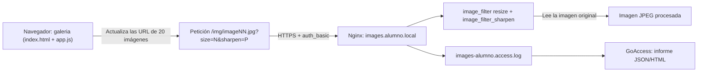

# Práctica guiada — Módulos de nginx: procesado de imágenes con `image_filter`

Repositorio para la práctica de administración y seguridad de servidores web utilizando Nginx en un contenedor Docker (`dpl-lab`), implementando HTTPS, autenticación básica, procesamiento de imágenes en el servidor y análisis de registros.



---

## 1. Instalación

Módulo `libnginx-mod-http-image-filter`, `ImageMagick` y `goaccess` dentro de `dpl-lab`; activación del módulo y comprobación con `nginx -V` / `nginx -T`.

La configuración y despliegue del servidor se realizan dentro de un contenedor Docker basado en Ubuntu (`dpl-lab`). Los componentes principales instalados y configurados son:

* **Módulo Dinámico `libnginx-mod-http-image-filter`**: Instalado para permitir el redimensionamiento, escalado y rotación de imágenes directamente en el servidor web Nginx mediante parámetros en la URL.
* **ImageMagick**: Utilizado para la creación y manipulación local de las imágenes originales en el entorno de desarrollo.
* **GoAccess**: Herramienta instalada para el análisis en tiempo real y la generación de informes estadísticos (formato JSON) a partir de los registros de acceso de Nginx.

* Para instalar el módulo `libnginx-mod-http-image-filter` ejecuta los siguientes comandos:

```bash
docker exec dpl-lab apt-get update
docker exec dpl-lab apt-get install -y libnginx-mod-http-image-filter
docker exec dpl-lab ls /etc/nginx/modules-enabled/          # 50-mod-http-image-filter.conf
docker exec dpl-lab grep -R "load_module" /etc/nginx/modules-enabled/   # -R sigue el enlace simbólico; -r no lo muestra
docker exec dpl-lab nginx -t                                # syntax is ok
```

### Verificación del Entorno
* **Comprobación de módulos activos**: Se verifica la correcta carga del módulo mediante la directiva `load_module` en el directorio de configuración (`/etc/nginx/modules-enabled/50-mod-http-image-filter.conf`).

* **Validación de sintaxis y configuración**: 
  - `nginx -t` para comprobar la sintaxis global de los archivos de configuración.
  - `nginx -T` para volcar la configuración completa de los bloques de servidor (*Server Blocks*).
  - `nginx -V` para revisar los módulos compilados y los argumentos de configuración del binario.

### Instalación de imagemagick y goaccess

```bash
docker exec dpl-lab apt-get install -y imagemagick goaccess
```

ImageMagick se utilizará para generar las imágenes originales, mientras que GoAccess se empleará para analizar el registro de acceso de la galería.

---


## 2. Generación de las imágenes

La galería utiliza 20 imágenes JPEG cuadradas de 400 × 400 píxeles, con nombres consecutivos desde image01.jpg hasta image20.jpg.

Crear el directorio: 
```bash
docker exec dpl-lab mkdir -p /var/www/images.alumno.local/img
```

* Comando con ImageMagick: Para crear el conjunto de pruebas inicial de la galería de forma automatizada, ejecutar el siguiente bucle dentro del contenedor:

```bash
docker exec dpl-lab bash -c 'for i in $(seq -w 1 20); do \
  convert -size 400x400 gradient:"#2f6fed"-"#8bc34a" \
    -fill white -pointsize 64 -gravity center -annotate 0 "IMG $i" \
    /var/www/images.alumno.local/img/image$i.jpg; done'
```

El bucle genera un degradado de color, añade una etiqueta centrada y guarda cada imagen en formato JPEG.

Verificar imágen:

```bash
docker exec dpl-lab identify /var/www/images.alumno.local/img/image01.jpg   # 400x400
```

### ¿Por qué no se versionan las imágenes?

* Los archivos binarios de imagen incrementan innecesariamente el peso del repositorio y ralentizan las operaciones de control de versiones. Al ser recursos generados dinámicamente (assets), se excluyen mediante el archivo .gitignore y se regeneran localmente en cada entorno de despliegue.

---

## 3. Configuración de Nginx

La configuración de images.alumno.local utiliza listas blancas para controlar los parámetros de procesamiento, HTTPS mediante un certificado autofirmado, autenticación básica y redirecciones.

El archivo de configuración del proyecto se encuentra en: `nginx/images.alumno.local`

### Listas blancas mediante map

Las directivas map se declaran en el contexto http de Nginx. Se define en `/etc/nginx/sites-available/images.alumno.local`con un enlace simbólico a `/etc/nginx/sites-enabled/`.

Se utilizan para aceptar únicamente los valores permitidos y aplicar un valor predeterminado cuando el cliente envía un parámetro no contemplado.

```conf
# Lista blanca de tamaños (evita peticiones de resize arbitrarias)
map $arg_size $img_size {
    default 300;
    150     150;
    300     300;
    600     600;
}

# Lista blanca de calidades JPEG
map $arg_q $img_quality {
    default 80;
    60      60;
    80      80;
    100     100;
}

# Lista blanca de enfoque (sharpen)
map $arg_sharpen $img_sharpen {
    default 0;
    0       0;
    30      30;
    60      60;
    100     100;
}
```

Los parámetros se obtienen de la URL:

* size: tamaño máximo solicitado.
* q: calidad de salida JPEG.
* sharpen: nivel de enfoque.

Por ejemplo: `/img/image01.jpg?size=150&q=60&sharpen=30`

### Generar el certificado autofirmado

Se ejecuta los siguientes comandos para generar el certificado autofirmado, primero crea el directorio donde se alojarán `/etc/ssl/dpl/`, ejecta el comando de generación del certificado y cambia los permisos a solo lectura para el usuario `root`.

```bash
docker exec dpl-lab mkdir -p /etc/ssl/dpl
docker exec dpl-lab openssl req -x509 -nodes -newkey rsa:2048 -days 365 \
     -keyout /etc/ssl/dpl/images.alumno.local.key \
     -out /etc/ssl/dpl/images.alumno.local.crt \
     -subj "/CN=images.alumno.local" \
     -addext "subjectAltName=DNS:images.alumno.local,DNS:www.images.alumno.local"
docker exec dpl-lab chmod 400 /etc/ssl/dpl/images.alumno.local.key
```

El certificado permite establecer conexiones HTTPS, pero al ser autofirmado los navegadores no confían automáticamente en él.

*Nota: Para copiar un archivo desde el contenedor Docker a PC Anfitrión ejecuta el domando `docker cp nombre_contenedor:/ruta_archivo ruta_directorio_pc_anfitrion`*

### Crear el usuario de la galería

Ejecuta los siguientes comandos para crear y escribir el usuario y contraseña cifrada, cambiar la propiedad del archivo al usuario `root`y al grupo `www-data` y cambiar los permisos a `640`, lo que significa que el usuario `root` puede leer y escribir, el grupo `www-data` solo puede leerlo, y el resto de usuarios del sistema no tienen ningún acceso.

```bash
docker exec dpl-lab bash -c 'echo "alumno:$(openssl passwd -apr1 CAMBIAR_ESTO)" > /etc/nginx/htpasswd-images'
docker exec dpl-lab chown root:www-data /etc/nginx/htpasswd-images
docker exec dpl-lab chmod 640 /etc/nginx/htpasswd-images
```

Los permisos 640 permiten que root lea y escriba el archivo, que el grupo www-data pueda leerlo y que el resto de usuarios no tenga acceso.

La contraseña se almacena como un hash generado por openssl passwd -apr1, no en texto plano. 

### Bloque HTTPS y ubicación de las imágenes

La siguiente configuración recoge las directivas principales que deben aparecer en el bloque HTTPS de la práctica. Debe integrarse con la configuración real de nginx/images.alumno.local.conf, manteniendo las redirecciones y el formato de registro que ya estén definidos.

El bloque HTTPS escucha en el puerto 443 y utiliza un certificado autofirmado ubicado en /etc/ssl/dpl/. La raíz del sitio web es /var/www/images.alumno.local, desde donde se sirve la página principal y sus recursos estáticos.

La ubicación /img/ aplica autenticación básica y utiliza el módulo ngx_http_image_filter_module para procesar las imágenes JPEG. Los parámetros size, q y sharpen se validan mediante las listas blancas definidas con map, estableciendo valores predeterminados cuando no se proporciona un valor permitido.

El acceso sin credenciales devuelve 401 Unauthorized. La ubicación interna @sin_autorizacion permite devolver ese código sin aplicar el filtro de imágenes a una respuesta que no contiene una imagen.

```conf
server {
    listen 443 ssl;
    listen [::]:443 ssl;
    server_name images.alumno.local;
    root /var/www/images.alumno.local;
    index index.html;

    ssl_certificate     /etc/ssl/dpl/images.alumno.local.crt;
    ssl_certificate_key /etc/ssl/dpl/images.alumno.local.key;

    location / {
        try_files $uri $uri/ =404;
    }

    # Procesado de imagenes: solo en /img
    location /img/ {
        auth_basic "Galeria de imagenes";
        auth_basic_user_file /etc/nginx/htpasswd-images;

        # Sin esto, image_filter convierte la pagina de error del 401 en un
        # 415 (el filtro rechaza cualquier cuerpo que no sea una imagen).
        error_page 401 @sin_autorizacion;

        image_filter resize $img_size $img_size;
        image_filter_sharpen $img_sharpen;
        image_filter_jpeg_quality $img_quality;
        image_filter_buffer 5M;
    }

    # Respuesta de autenticacion sin image_filter de por medio
    location @sin_autorizacion {
        return 401;
    }

    access_log /var/log/nginx/images-alumno.access.log;
    error_log  /var/log/nginx/images-alumno.error.log;
}
```
Las directivas cumplen las siguientes funciones:

* **auth_basic**: exige autenticación para acceder a las imágenes.
* **auth_basic_user_file**: indica la ruta del archivo de credenciales.
* **image_filter resize**: limita las dimensiones de salida de la imagen.
* **image_filter_sharpen**: aplica el enfoque en el servidor.
* **image_filter_jpeg_quality**: establece la calidad JPEG de salida.
* **image_filter_buffer 5M**: establece un límite de búfer de 5 MB para leer la respuesta de origen.
* **error_page 401 = @sin_autorizacion**: desvía la respuesta de autenticación a una ubicación que no aplica el filtro.

El filtro necesita recibir contenido de imagen. Si intenta procesar una respuesta de error que no es una imagen, puede producir un 415 Unsupported Media Type. La ubicación interna permite gestionar el 401 fuera de la ubicación que aplica image_filter.

La autenticación solo se aplica a `/img/`; el resto del sitio permanece público.

### Redirecciones HTTP y del dominio www

La configuración incluye dos bloques de servidor que gestionan las peticiones recibidas por HTTP en el puerto 80:

Las peticiones dirigidas a images.alumno.local se redirigen a HTTPS conservando la ruta y los parámetros de la URL.

Las peticiones dirigidas a www.images.alumno.local se redirigen al dominio principal `images.alumno.local`, también mediante HTTPS.

```conf
# HTTP -> HTTPS
server {
    listen 80;
    listen [::]:80;
    server_name images.alumno.local;
    return 301 https://$host$request_uri;
}

# www -> dominio base
server {
    listen 80;
    listen [::]:80;
    server_name www.images.alumno.local;
    return 301 https://images.alumno.local$request_uri;
}

# www -> dominio base (https)
server {
    listen 443 ssl;
    listen [::]:443 ssl;
    server_name www.images.alumno.local;

    ssl_certificate     /etc/ssl/dpl/images.alumno.local.crt;
    ssl_certificate_key /etc/ssl/dpl/images.alumno.local.key;

    return 301 https://images.alumno.local$request_uri;
}
```

### Activar, validar y recargar

```bash
# Crear el enlace simbólico solo si todavía no existe
docker exec dpl-lab bash -c 'test -e /etc/nginx/sites-enabled/images.alumno.local || ln -s /etc/nginx/sites-available/images.alumno.local /etc/nginx/sites-enabled/images.alumno.local'

# Validar la configuración antes de aplicarla
docker exec dpl-lab nginx -t

# Recargar Nginx si la validación es correcta
docker exec dpl-lab nginx -s reload

docker exec dpl-lab nginx -T | grep -E "server_name images|image_filter|load_module" | head
```
El orden profesional: activar → validar → aplicar. nginx -T muestra la configuración efectiva que Nginx carga, incluidas las directivas map, los bloques server y las ubicaciones configuradas. La carga del módulo dinámico se puede comprobar revisando los archivos de /etc/nginx/modules-enabled/ y la directiva load_module. nginx -V muestra los parámetros de compilación del binario, pero no demuestra por sí solo que el módulo dinámico esté cargado.

**Resultado esperado**: syntax is ok; en nginx -T aparecen load_module ... image_filter ..., la directiva image_filter y los server_name.

---

## 4. Aplicación web y reparto de responsabilidades

La galería utiliza tres archivos:

* `index.html`: define la estructura de la página y los controles.
* `app.js`: genera las miniaturas, actualiza sus URL y aplica los efectos visuales.
* `estilos.css`: establece la presentación general de la galería.

Se crean los archivos en `/var/www/images.alumno.local/`.

* `index.html`:

```html
<!DOCTYPE html>
<html lang="es">
<head>
    <meta charset="UTF-8">
    <meta name="viewport" content="width=device-width, initial-scale=1.0">
    <title>Galeria images.alumno.local</title>
    <link rel="stylesheet" href="estilos.css">
</head>
<body>
    <h1>Galeria de prueba</h1>
    <form id="controles">
        <label>Tamaño
            <select id="size">
                <option value="150">150</option>
                <option value="300" selected>300</option>
                <option value="600">600</option>
            </select>
        </label>
        <label>Ancho de borde
            <input type="range" id="border" min="0" max="12" value="2">
        </label>
        <label>Color del borde
            <input type="color" id="borderColor" value="#333333">
        </label>
        <label>Enfoque
            <select id="sharpen">
                <option value="0" selected>0</option>
                <option value="30">30</option>
                <option value="60">60</option>
                <option value="100">100</option>
            </select>
        </label>
        <label>Desenfoque
            <input type="range" id="blur" min="0" max="8" value="0">
        </label>
        <button type="submit">Generar</button>
    </form>
    <div class="galeria" id="galeria"></div>
    <script src="app.js"></script>
</body>
</html>
```

* `app.js`:

```js
const TOTAL = 20;

// El tamaño y el enfoque los procesa image_filter en el servidor: viajan en la URL.
function urlImagen(numero, size, sharpen) {
  const id = String(numero).padStart(2, "0");
  return `/img/image${id}.jpg?size=${size}&sharpen=${sharpen}`;
}

// Las 20 miniaturas se crean una sola vez.
function crearGaleria() {
  const contenedor = document.getElementById("galeria");
  for (let i = 1; i <= TOTAL; i++) {
    const img = document.createElement("img");
    img.alt = `Imagen ${i}`;
    contenedor.appendChild(img);
  }
}

// Borde, color y desenfoque son efectos de presentacion: los aplica el cliente.
function aplicarEfectos(borde, color, desenfoque) {
  document.querySelectorAll("#galeria img").forEach((img) => {
    img.style.borderStyle = "solid";
    img.style.borderWidth = `${borde}px`;
    img.style.borderColor = color;
    img.style.filter = desenfoque > 0 ? `blur(${desenfoque}px)` : "none";
  });
}

function render() {
  const size = document.getElementById("size").value;
  const sharpen = document.getElementById("sharpen").value;
  const borde = document.getElementById("border").value;
  const color = document.getElementById("borderColor").value;
  const desenfoque = document.getElementById("blur").value;

  document.querySelectorAll("#galeria img").forEach((img, indice) => {
    img.src = urlImagen(indice + 1, size, sharpen);
  });
  aplicarEfectos(borde, color, desenfoque);
}

document.addEventListener("DOMContentLoaded", () => {
  crearGaleria();
  document.getElementById("controles").addEventListener("submit", (evento) => {
    evento.preventDefault();
    render();
  });
  render();   // primer render con los valores por defecto
});
```

* `estilos.css`:

```css
body {
    font-family: system-ui, sans-serif;
    margin: 2rem;
}

#controles {
    display: flex;
    gap: 1rem;
    flex-wrap: wrap;
    align-items: end;
    margin-bottom: 1.5rem;
}

#controles label {
    display: flex;
    flex-direction: column;
    font-size: 0.85rem;
}

.galeria {
    display: flex;
    gap: 1rem;
    flex-wrap: wrap;
}

.galeria img {
    display: block;
}
```
El comando `chmod -R a+rX` concede permisos de lectura (r) y de búsqueda/ejecución en directorios (X) a todos los usuarios (a) de forma recursiva (-R) sobre la ruta `/var/www/images.alumno.local`.

```bash
docker exec dpl-lab chmod -R a+rX /var/www/images.alumno.local
```

### Reparto de responsabilidades entre cliente y servidor

`image_filter` **solo** aplica transformaciones como `resize`, `crop`, `rotate`, `sharpen` y `calidad`; no soporta bordes, colores ni desenfoque. Por eso la galería aplica el borde y su color con CSS y el desenfoque con `filter: blur(...)`, mientras que el tamaño y el enfoque viajan en la URL hasta nginx. Un módulo de terceros como `ngx_small_light` sí permitiría bordes y desenfoque en el servidor, pero requiere **compilarlo** contra la versión exacta de nginx: **es una ampliación opcional, no probada** en este curso.

---

## 5. Comprobación del funcionamiento

Las pruebas se realizan desde el contenedor dpl-lab, utilizando curl, identify, openssl y GoAccess.

### Página pública

```bash
# La página pública responde
docker exec dpl-lab curl -k -I https://localhost/ -H "Host: images.alumno.local"          # 200
```
Resultado esperado: 200 OK, siempre que la página principal exista y esté correctamente publicada.

### Autenticación básica: 401 sin credenciales

```bash
# /img está protegido: 401 sin credenciales
docker exec dpl-lab curl -k -I "https://localhost/img/image01.jpg" -H "Host: images.alumno.local"   # 401
```
Resultado esperado: 401 Unauthorized.

### Autenticación básica: 200 con credenciales

```bash
docker exec dpl-lab curl -k -I \
  -u alumno:CAMBIAR_ESTO \
  https://localhost/img/image01.jpg \
  -H "Host: images.alumno.local"
```
Resultado esperado: 200 OK, siempre que la autenticación sea correcta y el archivo exista.

### Redimensionado de una imagen

```bash
# Imagen sin ampliar: size=600 (mayor que el original) devuelve 400x400
docker exec dpl-lab curl -k -u alumno:CAMBIAR_ESTO -o /tmp/original.jpg \
    "https://localhost/img/image01.jpg?size=600" -H "Host: images.alumno.local"
docker exec dpl-lab identify /tmp/original.jpg        # 400x400 (no se amplia)
```
Como las imágenes originales miden 400 × 400 píxeles, image_filter resize no las amplía hasta 600 × 600. El resultado esperado es 400x400.


Solicitar una miniatura de 150 píxeles con calidad 60 y enfoque 30:

```bash
# Miniatura generada por image_filter (150x150, con mas enfoque)
docker exec dpl-lab curl -k -u alumno:CAMBIAR_ESTO -o /tmp/mini.jpg \
    "https://localhost/img/image01.jpg?size=150&q=60&sharpen=30" -H "Host: images.alumno.local"
docker exec dpl-lab identify /tmp/mini.jpg            # 150x150
```
Resultado esperado: 150x150.

### Redirección de HTTP a HTTPS

```bash
docker exec dpl-lab curl -I http://localhost/ -H "Host: images.alumno.local"          # 301 -> https
```
Resultado esperado: 301 Moved Permanently, con destino HTTPS.

### Redirección de www al dominio principal

```bash
docker exec dpl-lab curl -I http://localhost/ -H "Host: www.images.alumno.local"      # 301 -> images.alumno.local
```
Resultado esperado: una redirección 301 al dominio canónico images.alumno.local mediante HTTPS.

### Redirección HTTPS de www al dominio principal

```bash
docker exec dpl-lab curl -I http://localhost/:443 -H "Host: www.images.alumno.local"
````

### Certificado HTTPS

```bash
# Certificado
docker exec dpl-lab openssl s_client -connect localhost:443 -servername images.alumno.local 2>&1 | grep -E "subject=|issuer="
```

La salida debe permitir comprobar el certificado presentado por el servidor. Al tratarse de un certificado autofirmado, no se espera que los clientes lo consideren automáticamente de confianza.

### Análisis de registros con GoAccess

Generar el informe JSON:

```bash
docker exec dpl-lab goaccess /var/log/nginx/images-alumno.access.log \
    --log-format=COMBINED -o /home/alumno/dpl/informe-images.json
```
Generar el informe HTML:

```bash
docker exec dpl-lab goaccess /var/log/nginx/images-alumno.access.log \
    --log-format=COMBINED -o /home/alumno/dpl/informe-images.html
```

Consultar las últimas peticiones:

```bash
docker exec dpl-lab tail -n 10 /var/log/nginx/images-alumno.access.log
```

GoAccess permite analizar las peticiones registradas, las URL solicitadas, los códigos HTTP y otras estadísticas disponibles en el registro.

---

## 6. Problemas encontrados

### Error al cargar el certificado SSL

Durante la validación de la configuración se produjo el siguiente error:

```bash
cannot load certificate "/etc/ssl/dpl/imgaes.alumno.local.crt":
BIO_new_file() failed
No such file or directory
nginx: configuration file /etc/nginx/nginx.conf test failed
```
La causa era una errata en el nombre del certificado: se había escrito imgaes en lugar de images.

La ruta correcta es: `/etc/ssl/dpl/images.alumno.local.crt`

Se corrigió el nombre del archivo en la configuración y se volvió a comprobar:
```bash
docker exec dpl-lab nginx -t
```
Una vez validada la configuración, se pudo recargar Nginx.

### Posible error unknown directive "image_filter"

Si Nginx muestra un error como:
```bash
unknown directive "image_filter"
```
Significa que no reconoce la directiva. Una causa habitual es que el módulo dinámico no esté instalado o no se haya cargado.

Para comprobarlo:
```bash
docker exec dpl-lab dpkg -l libnginx-mod-http-image-filter
docker exec dpl-lab ls -l /etc/nginx/modules-enabled/
docker exec dpl-lab nginx -T
docker exec dpl-lab nginx -t
```

La solución consiste en instalar y activar el módulo compatible con la versión de Nginx y verificar que la configuración carga el módulo antes de utilizar sus directivas.

### Posible error 415 Unsupported Media Type

El filtro de imágenes necesita procesar contenido que pueda interpretar como imagen. Si recibe una respuesta de error, como el 401 de la autenticación, puede producir un 415 Unsupported Media Type.

Para evitarlo, la configuración desvía el error a una ubicación interna que no aplica image_filter:

```conf
error_page 401 = @sin_autorizacion;

location @sin_autorizacion {
    return 401;
}
```

Así se mantiene el comportamiento esperado de la autenticación sin aplicar el filtro a una respuesta que no es una imagen.

---

## 7. Respositorio Remoto

El repositorio remoto de la práctica es: [https://github.com/manuelgm92/ae3](https://github.com/manuelgm92/ae3)

### Estructura del proyecto

```md
ae3/
├── README.md
├── certs
│   ├── LEEME.md
│   └── images.alumno.local.crt
├── comprobaciones.txt
├── nginx
│   └── images.alumno.local
└── web
    ├── app.js
    ├── estilos.css
    └── index.html

4 directories, 8 files
```

### Comprobaciones finales de Git

Desde el directorio del repositorio:
```bash
git status
git log --oneline
git log --format='%an <%ae>' | sort -u
```
Estas órdenes permiten revisar el estado del repositorio, el historial de commits y los datos de autoría.